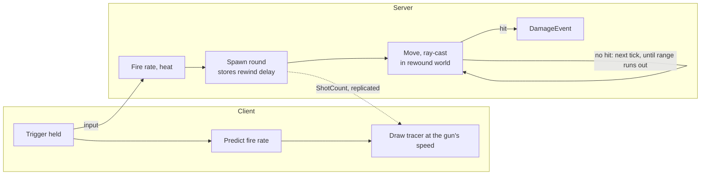

# Gun Bullet Travel and Lead Reticle — Design

14 Nov 2026 · Status: design, not built. Live copy: https://claude.ai/artifact/2yv8aaD6Ho7Qgk1qshd3yT

## Summary

Nose-gun rounds get real travel time (about 0.4–0.9 s to full range), so players must lead moving targets, and a gun lead reticle shows where to aim. Today the gun hits instantly, so a target that keeps flying straight is trivial to hit and dodging does nothing.

- **Server bullets:** the server moves each round every tick and ray-casts the short segment it covered. No ghost per round.
- **Lag compensation kept:** each round uses the rewound world, by the delay the shooter had when it was fired, as today's hitscan does.
- **Lead reticle:** a gun lead marker on the target the nose points at, built on the existing rocket lead.
- **Per-gun speed:** a new `bulletSpeed` field on each gun; 0 keeps a gun instant (the pulse laser).

## Current gun

The gun is hitscan: one ray along the nose, damage the same tick (`HitscanFireSystem`).

- **Fire rate:** predicted on client and server; `HitscanWeaponState.ShotCount` is replicated and drives the tracers.
- **Lag compensation:** the server ray-casts in the physics world as the shooter saw it, rewound by their interpolation delay, capped at 0.2 s (`MaxRewindSeconds`).
- **Damage:** `GunDamage.At` with range falloff; hits become `DamageEvent`s.
- **Tracers already fly:** `GunEffectsSystem` moves them at `gunBulletSpeed` = 900 m/s, one value for every gun. So the picture already shows travel time while the hit is instant: what you see and what hits do not match.
- **Bots:** `BotBrain` aims the gun straight at the target ("the gun is hitscan (no lead)"); only rockets get a lead (`RocketSpeed`).
- **Rocket lead:** `WorldMarkerSystem.UpdateLead` already draws a lead for the selected rocket pylon with `Guidance.InterceptTime`.

## Design: server bullets

The server owns every round; clients only draw them. A round is a small struct in a server buffer, not a networked entity, so a 3,000 rpm gun costs no bandwidth beyond today's `ShotCount`.

1. **Fire (client and server, predicted):** the fire rate, heat and `ShotCount` stay as today.
2. **Spawn (server):** on each shot, add an `ActiveBullet` to a singleton buffer: position (muzzle), velocity (chopper velocity + nose × `bulletSpeed`), time left (`range / bulletSpeed`), damage config, shooter, and the rewind delay the shooter had at fire time (capped 0.2 s, as now).
3. **Step (server, every tick):** move each round by velocity × dt and ray-cast that segment (`Explosions.TryRaycast`) in the collision world rewound by the round's stored delay. A hit adds a `DamageEvent` (falloff by distance flown) and removes the round; time left ≤ 0 removes it.
4. **Draw (clients):** `GunEffectsSystem` keeps drawing a tracer per new `ShotCount`, but with the gun's own `bulletSpeed` instead of the one global 900 m/s. Impact sparks come from the existing hit events.

Only the shot count crosses the network; the round itself lives on the server until it hits or its range runs out.

**Why the stored delay:** the shooter aimed at where they saw the target. Rewinding by their delay for the whole flight keeps the lead they saw correct, the same rule hitscan uses at fire time.

**Pure core:** the step (move, segment, expire) goes in a pure `Ballistics` struct, so tests cover it without a world, like `GunDamage` and `Guidance`.

## Bullet speed per gun

Each gun gets `bulletSpeed` (m/s) on `HitscanWeaponDefinition`, baked to `HitscanWeaponConfig`. Speed gives each gun a feel: slow heavy rounds need a big lead, the railgun almost none. First guesses, tuned in play:

| Gun | Range (m) | Speed (m/s) | Time to full range (s) | Lead on a target crossing at 80 m/s, at full range (m) |
| --- | --- | --- | --- | --- |
| Railgun | 1200 | 3000 | 0.40 | 32 |
| M134 Minigun / Mk II | 600 | 900 | 0.67 | 53 |
| Heavy MG | 650 | 850 | 0.76 | 61 |
| Rotary Cannon | 450 | 800 | 0.56 | 45 |
| Autocannon | 700 | 750 | 0.93 | 75 |
| Chain Gun | 750 | 800 | 0.94 | 75 |
| Pulse Laser | 500 | 0 (instant) | 0 | 0 |

The pulse laser stays instant on purpose: its trade is short range and low damage for no lead. Gravity on rounds is left out at first; at these speeds and ranges the drop is small.

## Lead reticle

The gun gets its own lead marker, always on while a target is near the nose; the rocket lead stays as it is and shows only with a rocket pylon selected.

- **Target:** the locked target, else the target closest to the nose within 15° (the rocket lead's rule, `TargetNearestTheNose`).
- **Point:** `Guidance.InterceptTime(target − muzzle, target velocity − own velocity, bulletSpeed)`, then target + relative velocity × time. No point when the time is past the gun's range.
- **Look:** a small ring in the gun colour; the rocket lead keeps its own shape, so both can show at once without confusion.
- **Code:** `WorldMarkerModel` gets a second lead (`GunLead`), `WorldMarkerSystem.UpdateLead` is split into one shared intercept step used twice, and the HUD view draws both.
- **Instant guns** (pulse laser, speed 0): no gun lead.

## Other touch points

| Area | Change |
| --- | --- |
| Bots (`BotBrain`, `BotFlight`) | Aim the gun at the intercept point with the gun's `bulletSpeed`, as they already do for rockets. Bot skill can add aim error to the lead. |
| Tracers (`GunEffectsSystem`) | Use the gun's own speed; the global `gunBulletSpeed` (900) becomes the fallback only. |
| Hit markers | Come from the hit event as now, so they now show when the round lands, not on the trigger. |
| Hangar | Show bullet speed in the gun's stats. |
| Match log | A `Shot` entry stays at fire time; the hit entry gets the flight distance. |
| Pilot traits | `GunDamageMultiplier` and bullet damage-over-time still apply at hit time. |
| Optics zoom | No change; the gun lead also shows in zoom. |

## Risks and limits

- **Server load:** 8 players × a 3,000 rpm gun × 0.7 s flight is about 280 live rounds, each one short ray-cast per tick. Fine for Unity Physics, but check the `[Load]` log on the 0.5 vCPU Edgegap server. Mitigation: a cap on live rounds per shooter.
- **History length:** each step rewinds by the stored delay from the current tick, never from the fire tick, so the physics history only needs 0.2 s (12 ticks at 60 Hz), as today. Check that the history size is at least that.
- **Tracer and hit can differ:** the tracer starts from the client's predicted muzzle; the server round starts from the server muzzle. A small gap is normal; a large one shows as "hit behind the tracer".
- **Feel:** hitting gets harder. The lead reticle and tuned speeds must make it learnable; tune with the first playtest.
- **Bots get worse at first** until their lead uses the new speed (part of step 4 below).

## Build steps

Five steps, each one compiles and plays on its own:

1. **Data:** `bulletSpeed` on `HitscanWeaponDefinition` and `HitscanWeaponConfig`; setup code sets the speeds in the table; 0 = instant.
2. **Pure core:** `Ballistics.Step` (move, segment, expire) and the gun intercept point; EditMode tests (a round hits a target that flew into its path, misses one that left; expires at range; speed 0 stays instant).
3. **Server rounds:** `HitscanFireSystem` spawns rounds instead of one ray when speed > 0; a new `BulletStepSystem` (server, after physics export) steps them with the stored rewind; same `DamageEvent`. The name `Hitscan*` stays for now to avoid a big rename.
4. **Bots and tracers:** bot gun aim leads with the gun's speed; tracers use the gun's speed.
5. **HUD:** gun lead marker; hangar stat.

**Editor steps for the owner:** delete `Library/BurstCache` (new Burst systems), run Setup step 1 with a match scene open, Validate, reopen the gameplay subscene so the chopper prefab bakes, then fly Training against bots and check the `[Load]` log.

**Tests in play:** lead a crossing bot with the reticle and hit it; a round hits a target that turns into its path; the pulse laser still hits instantly; two clients with 150 ms ping still hit a straight-flying target by leading the reticle.

## Open decisions

- [ ] Bullet speeds: accept the table, or slower for a bigger lead skill gap?
- [ ] Pulse laser: keep it instant as its trade, or give it travel time too?
- [ ] Gun lead marker: always on near a target, or only with a lock?
- [ ] Gravity on rounds: leave out (proposed), or add a small drop for long range?
- [ ] Cap on live rounds per shooter, if the server load test needs one?
